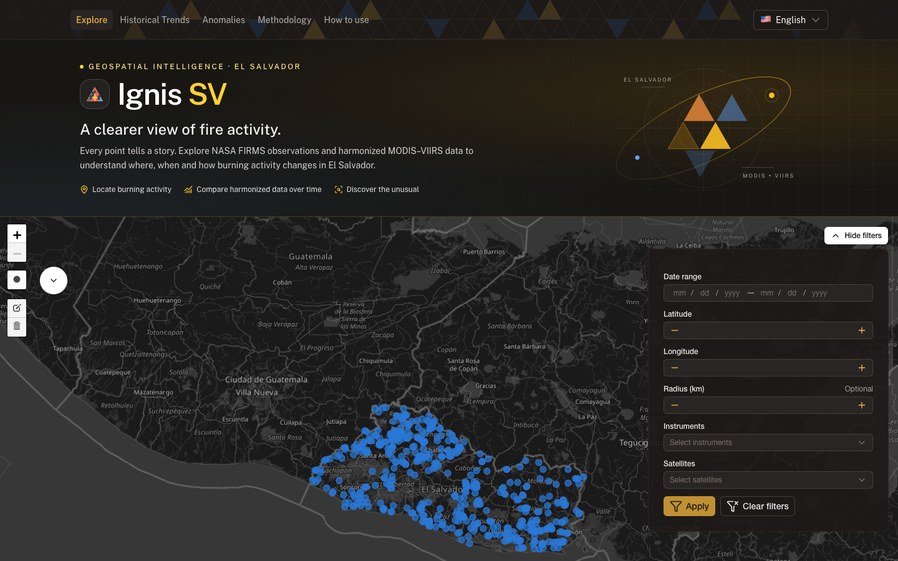
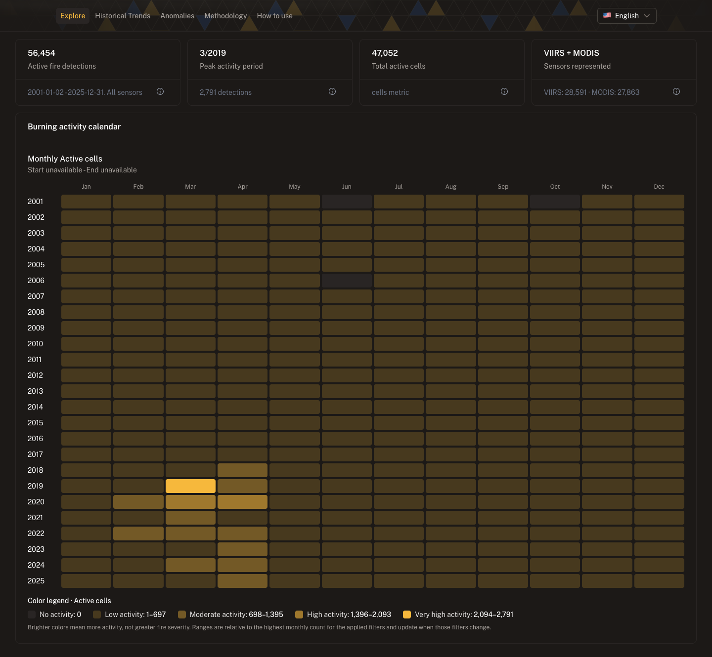
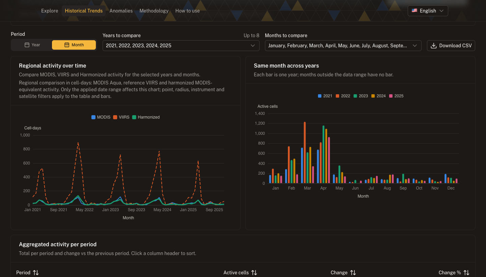
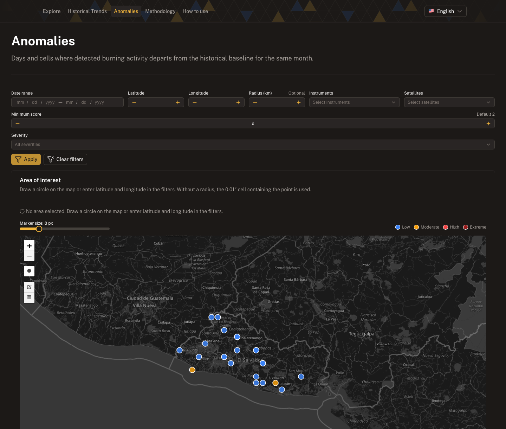
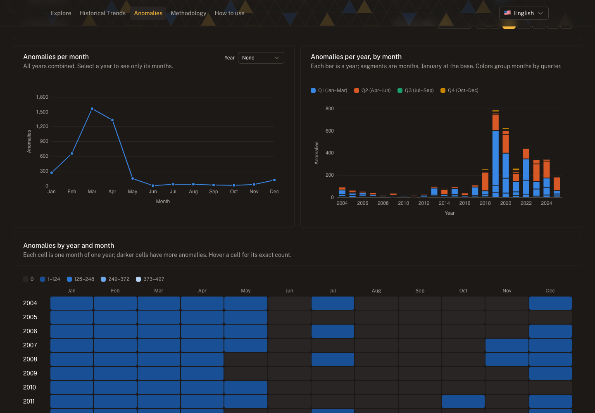

# Ignis SV

Harmonized burning activity calendar for El Salvador, built for the NASA Space Apps Challenge by team **Orbit 503**.

Ignis SV combines more than two decades of NASA FIRMS active fire hotspots from **MODIS** and **VIIRS** into a single, comparable record, so that patterns, trends and anomalies matter more than the sensor that captured them. It is aimed at emergency responders, scientists and land managers who need to know where and when burning has occurred, and how current activity compares with history.

Live site: [orbit503.earth](https://orbit503.earth)

## Features

| Page | What it answers |
| --- | --- |
| **Explore** | Where and when is burning activity detected? Interactive map, summary and monthly activity calendar with an accessible color ramp. |
| **Historical Trends** | How does activity change between months and years? Sortable table, bar chart, MODIS / VIIRS / harmonized regional series and CSV download. |
| **Anomalies** | Which observations depart from their history? Cell-by-day anomalies against the same-month baseline, with severity, maps and charts. |
| **Methodology** | How the data is unified, harmonized and validated. |
| **How to use** | An in-app guide to every page, with screenshots, in English and Spanish. |

All analysis pages share one set of filters: date range, instruments, satellites and an area of interest, either drawn as a circle on the map or entered as latitude/longitude with an optional radius. Filters are applied explicitly and stored in the URL, so a view can be reloaded or shared.

The interface is available in English and Spanish.

## How to use

Use the top navigation to move between pages and the language menu in the top-right corner to switch between English and Spanish.

### Filters (all pages)

Explore, Historical Trends and Anomalies share the same filters, and they stay in sync as you move between pages.

1. **Date range**: pick a start and end date. With no dates, the full record is used.
2. **Area of interest** (optional): choose one of these:
   - Draw a circle on the map with the circle tool in the map toolbar. The trash icon removes it.
   - Click **Select a point**, then click the map to fill in latitude and longitude.
   - Type **Latitude** and **Longitude** yourself, and optionally a **Radius (km)** of up to 300 km. Without a radius, only the 0.01° cell that contains the point (about 1 km per side) is searched.

   The area must be inside El Salvador.
3. **Instruments** and **Satellites** (optional): limit results to MODIS or VIIRS, or to specific satellites.
4. Press **Apply**. Nothing is queried until you apply, so you can adjust several filters first. **Clear filters** resets the search.

Applied filters are saved in the URL, so you can bookmark or share a view and reload it later.

### Explore



The landing page shows where burning activity is detected.

- Each point on the map is a satellite detection: **blue for MODIS**, **orange for VIIRS**. Click a point to see its acquisition date and time, fire radiative power (FRP) and confidence.
- The map shows the first 500 detections. Use **Load more points** to draw more (up to 5,000), or narrow the filters to focus on an area or period.
- **Hide filters** / **Show filters** collapses the filter panel so you can see more of the map.
- Use the round arrow button, or scroll down, to reach the summary and calendar.



- **Summary cards** show total detections, the peak activity month, total active cells and the detections per sensor for the applied filters.
- The **burning activity calendar** has one row per year and one column per month. Brighter cells mean more activity. The legend gives the range for each color, and those ranges recalculate whenever the filters change. Brighter means more activity, not more severe fires.

### Historical Trends



Compare burning activity across months and years.

1. Apply the shared filters at the top of the page. The page also includes a map of detections for context.
2. Choose the **Period**: **Month** compares the same months across years, and **Year** compares annual totals.
3. Pick up to 8 **Years to compare** and, in Month mode, the **Months to compare**.
4. Read the charts:
   - **Regional activity over time** plots MODIS, VIIRS and the **Harmonized** series in comparable cell-day units. This chart covers the whole region and only reacts to the date range.
   - **Same month across years** (or **Year-over-year totals**) compares the selected years side by side, using every applied filter.
5. The **Aggregated activity per period** table lists every period with its total, absolute change and percentage change. Click a column header to sort.
6. **Download CSV** exports the table together with the applied filters.

### Anomalies



Find days and places where activity was unusually high compared with previous years in the same month.

1. Set the shared filters, plus two filters specific to this page:
   - **Minimum score**: how far above the baseline an observation must be to count as an anomaly (default 2).
   - **Severity**: show only Low, Moderate, High or Extreme anomalies.
2. Press **Apply**.
3. The map shows the anomalies on the current table page, colored by severity. Click a marker for details, and use the **Marker size** slider to make markers easier to see.
4. The table lists each anomaly's date, location, score, observed and expected detections, and severity. Sort by clicking a column header, change **Rows per page**, and page through the results. **Download CSV** exports every matching anomaly, not just the current page.



Below the table, the charts summarize all matching anomalies:

- **Anomalies per month**: all years combined. Pick a **Year** to see only its months.
- **Anomalies per year, by month**: stacked bars, with months grouped by quarter color.
- **Anomalies by year and month**: a heatmap. Hover a cell for its exact count.
- **Anomaly score over time**: each point is an anomaly, colored and sized by severity. Scroll or drag the slider to zoom into a period.

### Methodology


This page explains where the data comes from, how the MODIS and VIIRS records are unified and harmonized, how the results are validated, and the business intelligence model behind the indicators. Use the buttons at the top to jump to a section.

## Tech stack

- [Nuxt 4](https://nuxt.com) + [Nuxt UI](https://ui.nuxt.com) and Tailwind CSS
- [Leaflet](https://leafletjs.com) and Leaflet.draw for maps and area selection
- [Apache ECharts](https://echarts.apache.org) via `nuxt-echarts` for charts
- `nuxt-open-fetch` for typed API clients generated from [openapi/api/openapi.yaml](openapi/api/openapi.yaml)
- `@nuxtjs/i18n` for EN/ES translations
- Vitest, ESLint and `vue-tsc`

## Getting started

Requirements: Node.js 24 and pnpm.

```bash
pnpm install
cp .env.example .env
pnpm dev
```

The app runs on `http://localhost:3000` and redirects to `/explore`.

### Environment variables

| Variable | Description |
| --- | --- |
| `NUXT_API_BASE_URL` | Base URL of the Ignis SV backend API. Server only. |
| `NUXT_API_KEY` | API key sent as `x-api-key`. Server only. |
| `USE_MOCKS` | `true` serves the JSON fixtures in [data/](data/) instead of calling the API. |
| `NUXT_PUBLIC_MAP_TILE_URL` | Base map tile URL template. |
| `NUXT_PUBLIC_MAP_ATTRIBUTION` | Attribution HTML for the base map. |

The browser never talks to the backend directly. Every request goes to `/api/**` on the Nuxt server ([server/routes/api/[...path].ts](server/routes/api/[...path].ts)), which forwards it to `NUXT_API_BASE_URL` with the `x-api-key` header, so the key is never shipped in the client bundle. These variables are read at runtime and must also be set where the production server runs. Never commit `.env`.

## Scripts

| Command | Description |
| --- | --- |
| `pnpm dev` | Start the development server |
| `pnpm build` | Build for production |
| `pnpm preview` | Preview the production build locally |
| `pnpm lint` | Run ESLint |
| `pnpm typecheck` | Run type checking |
| `pnpm test` | Run the Vitest suite |

## Deployment

The app ships as a Docker image built from the [Dockerfile](Dockerfile): a Node 24 image that runs the Nitro server (`.output/server/index.mjs`) on port 3000. Provide `NUXT_API_BASE_URL`, `NUXT_API_KEY` and the map variables to the container at runtime.

```bash
docker build -t ignis-sv .
docker run -p 3000:3000 --env-file .env ignis-sv
```

[CI](.github/workflows/ci.yml) runs lint and typecheck on pushes and pull requests to `main` and `dev`. Every push to `main` also builds and pushes the image and triggers a production deploy on Dokploy at [orbit503.earth](https://orbit503.earth).

## Project structure

```
app/
  pages/          Explore, Historical Trends, Anomalies, Methodology
  components/     UI, maps, charts and shared filters
  composables/    Filter state, data loading and aggregation
  services/       API services (with mock fallback)
  types/ enums/   API types and enums
data/             Mock API responses
docs/             Challenge, methodology, validation and BI model
i18n/locales/     English and Spanish translations
openapi/api/      Backend OpenAPI contract
server/routes/    API proxy
test/             Unit tests
```

When the OpenAPI contract changes, regenerate services and mocks following [AGENTS.md](AGENTS.md) and the standards in [.agents/](.agents/).

## Documentation

- [Challenge](docs/challenge.md)
- [Library selection](docs/libraries.md)
- [Business intelligence model](docs/business-intelligence-model.md) (Spanish)
- [Historical trends validation](docs/historical-trends-validation.md)
- [Map and shared filters validation](docs/map-validation.md)

## Data

Active fire data: [NASA FIRMS](https://firms.modaps.eosdis.nasa.gov/) (MODIS and VIIRS). Base map: © OpenStreetMap contributors.

## License

[MIT](LICENSE)
