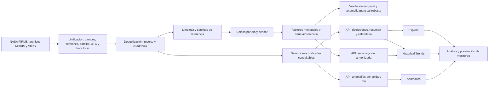
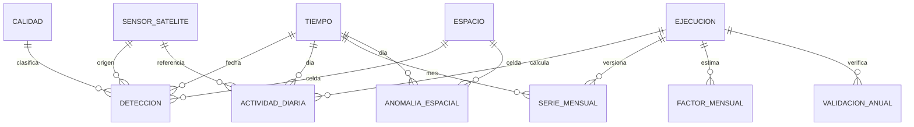

# Modelo de inteligencia de negocio — Ignis SV

Modelo conceptual derivado del código de Explore, Historical Trends, Anomalies, el contrato `openapi/api/openapi.yaml` y el notebook proporcionado `Armonizacion_corregido (1).ipynb`. Documenta la aplicación existente y propone una organización dimensional para su análisis; **no afirma que estas tablas físicas existan en el backend**.

## Propósito y decisiones

Apoyar a analistas, investigadores y equipos de monitoreo en tres preguntas:

| Pregunta | Vista y evidencia | Decisión apoyada |
| --- | --- | --- |
| ¿Dónde y cuándo se detecta actividad de quema? | Explore: mapa, resumen y calendario mensual | Delimitar zonas y temporadas que ameritan revisión |
| ¿Cómo varía la actividad entre meses o años? | Historical Trends: tabla, barras, tres series regionales y CSV | Comparar temporadas y reconocer recurrencia |
| ¿Qué observaciones se apartan de su historia? | Anomalies: anomalías por celda y día, tabla, mapas y gráficas | Priorizar inspección de actividad estadísticamente inusual |

No se implementan pronósticos, pruebas estadísticas de tendencia, causalidad, medición de daños ni identificación de incendios únicos. La priorización analítica no equivale a un sistema de alertas operativas en tiempo real.

## Flujo y linaje

Colab es la implementación científica de referencia. La API publica sus cálculos y parámetros de ejecución; el navegador consulta y presenta esos resultados. No ejecuta el notebook al abrir una página. El diagrama no presupone que todo lo visible haya pasado por la limpieza y selección de la serie armonizada: Explore puede incluir todos los satélites y confianzas admitidos por su consulta.

## Matriz de procesos y dimensiones

| Proceso / hecho | Tiempo | Espacio | Sensor / satélite | Calidad | Ejecución / referencia |
| --- | --- | --- | --- | --- | --- |
| Detección unificada | Instante UTC y día local | Coordenadas, celda | Ambos | Confianza, tipo, versión | Lote de origen / consulta |
| Actividad diaria | Día local | Región y, en detalle derivado, celda | Sensor; selección de referencia | Cobertura | Proceso de armonización |
| Serie armonizada | Mes y año | Región fija de ejecución | MODIS Aqua y VIIRS de referencia | Mes completo | Parámetros y factores |
| Anomalía espacial | Día y mes calendario de referencia | Celda | Filtros de consulta | Referencia suficiente | Años previos y consulta |
| Validación | Año excluido / meses alineados | Misma región | Series comparadas | Pares válidos | Ejecución local y API |

Dimensiones conformadas propuestas:

- **Tiempo**: fecha UTC, fecha local de El Salvador, mes, año, mes calendario y época. La UTC se conserva junto a UTC−6; las fechas de la interfaz para adquisiciones se formatean en UTC. No equiparar automáticamente un día UTC con un día local del Colab.
- **Espacio**: coordenadas, índices de celda angular de 0.01°, rectángulo de estudio y geometría consultada. El recorte no es un límite administrativo nacional y el área de una celda varía con la latitud.
- **Sensor / satélite**: MODIS/VIIRS y plataforma. La combinación válida sensor–satélite es un atributo de referencia, no una multiplicación de observaciones. La selección de armonización no cambia por los filtros interactivos del usuario.
- **Calidad**: confianza normalizada, tipo de fuente, procedencia, cobertura, mes completo y estado de cálculo. La confianza es una categoría, no una medida aditiva.
- **Ejecución**: identificador lógico o fecha de cálculo, versión de datos y método, `HarmonizationRun.params`, rango efectivo de traslape, años de referencia y conteos tras cada etapa. La API expone la fecha y parámetros; un identificador persistente de versión es una recomendación de trazabilidad, no una funcionalidad demostrada.

## Constelación de hechos propuesta

| Hecho lógico | Grano y clave lógica | Medidas / atributos | Aditividad |
| --- | --- | --- | --- |
| Detección | Satélite + instante UTC + latitud/longitud redondeadas a 4 decimales; `id` de API para presentación | Conteo = 1, FRP en MW, bandas térmicas, confianza, tipo | Conteo aditivo tras deduplicar. FRP no debe sumarse entre fechas como si fuera energía o superficie quemada |
| Actividad diaria por sensor | Ejecución + día local + sensor sobre su región | `nunique(celda)`; satélite de referencia y cobertura | Aditiva entre días para obtener celdas-día. Entre sensores puede haber superposición espacial y temporal |
| Factor mensual | Ejecución + mes calendario (1–12) | Sumas MODIS/VIIRS, razón mensual, razón de época, factor elegido y origen | Factores y razones no aditivos; no promediar razones para sustituir la razón de sumas |
| Serie mensual regional | Ejecución + mes | MODIS, VIIRS, armonizado, fuente, completitud, mediana, p25, p75 y anomalía | Valores completos sumables a año; anomalías, percentiles y factores no sumables |
| Anomalía espacial diaria | Celda + día + contexto de consulta / referencia | Observado, esperado, ratio, score, nivel, FRP máxima, años de referencia | Conteo de filas = celdas-día anómalas; scores y ratios no sumables |
| Validación anual LOYO | Ejecución + año excluido | Meses evaluados, MODIS, VIIRS crudo y corregido, diferencia porcentual | Totales compatibles sumables; porcentajes requieren recálculo |
| Consistencia Local/API | Versiones local y publicada + rango de meses comunes; detalle por mes y resumen por año | Error, error absoluto/cuadrático, MAE, RMSE, sesgo, relativo y correlación | Recalcular sobre pares válidos; no promediar sin pesos resúmenes de distinto tamaño |

Los hechos agregados por celda y día y las selecciones dinámicas de área pueden calcularse sobre consultas, sin materializar una nueva tabla por cada área. Una consulta constituye contexto analítico; no es otra detección.

## Catálogo de indicadores y reglas

| Indicador | Definición y unidad | Alcance actual |
| --- | --- | --- |
| Detecciones activas | Número de observaciones unificadas que cumplen la consulta | Resumen de Explore y conteo total del mapa |
| Actividad `cells` | Celdas distintas por día, agregadas a periodo; celdas-día | Calendario, tabla y barras; la etiqueta de la API es `cells` |
| Actividad por sensor | Misma métrica solicitada por separado para MODIS / VIIRS | Columnas filtradas de CSV; puede haber celdas compartidas |
| Cambio absoluto | Actual − anterior | Periodo anterior cronológico; primer periodo sin comparación |
| Cambio porcentual | 100 × (actual − anterior) / anterior | 0→0: 0 %; 0→positivo: indefinido; primer periodo: ausente |
| Armonizado | MODIS antes del traslape; VIIRS × factor después | Región y parámetros del servidor, fechas seleccionadas, equivalentes MODIS con decimales |
| Pico de actividad | Periodo con máximo conteo de la métrica consultada | No equivale necesariamente a máxima intensidad física de incendios |
| Score espacial diario | 2 × (√(observado + 3/8) − √(esperado + 3/8)) | Anomalies; esperado: promedio diario de esa celda en el mismo mes de años anteriores |
| Anomalía mensual robusta | (armonizado − mediana del mes) / (p75 − p25) | Colab / contrato de armonización; referencia configurada 2003–2025 |

### Dos escalas de anomalías

- **Mensual robusta** (`HarmonizedAnomalyLevel`): muy bajo ≤ −1; bajo (−1, −0.5]; normal (−0.5, 0.5]; alto (0.5, 1]; muy alto > 1. Son los intervalos de `pd.cut` del notebook. IQR cero y mes incompleto: ausente.
- **Espacial diaria** (`Severity`): baja [2, 3), moderada [3, 5), alta [5, 8), extrema ≥ 8; por debajo de 2, normal. La página filtra niveles no normales y un score mínimo. No corresponde a la misma referencia ni unidad que el indicador mensual.

### Interacción y alcance de cada vista

- Los filtros globales tienen borrador y valores aplicados; Aplicar fija la consulta, conservada entre páginas. Limpiar filtros suspende la búsqueda. Quitar área elimina solo la restricción espacial.
- Punto sin radio: celda local angular de 0.01°. Radio explícito: círculo; no es obligatorio. Esto no modifica el recorte de la serie regional armonizada.
- Mapa de detecciones: carga inicial 500 puntos; carga adicional hasta 5.000. El total mostrado puede ser mayor que los puntos dibujados. MODIS azul, VIIRS anaranjado.
- Historical Trends: tabla y barras siguen área, fechas, instrumentos y satélites. Las tres curvas regionales usan únicamente fechas. La selección de años/meses modifica gráficas, no recorta la tabla ni el CSV. El cambio se calcula antes de ordenar filas.
- CSV histórico: UTF-8 con BOM, encabezados localizados, periodo y cambios, MODIS/VIIRS filtrados, MODIS/VIIRS/armonizado regionales. Mantiene el orden de la tabla y el significado distinto de las columnas; no contiene metadatos «Applied filters» ni «Regional data scope» como columnas extras.
- Anomalies: el mapa usa la página actual; las gráficas cargan todas las filas coincidentes, con confirmación para consultas grandes. El CSV también pagina todos los resultados. No inferir un total nacional a partir de los puntos de una sola página.

## Validación en Google Colab

### Validez temporal del ajuste

El factor por mes es una **razón de sumas** sobre meses completos del traslape, cuyo límite configurado es 2025-12. El inicio y fin efectivos dependen de los datos. Si el denominador VIIRS mensual es menor de 30 celdas-día se usa el factor de época; denominadores cero deben marcarse sin cálculo válido.

La validación leave-one-year-out excluye cada año al estimar factores y contrasta su agregado anual corregido con MODIS. La correlación mensual que usa factores de todo el traslape es descriptiva. No confundir ambas evaluaciones ni interpretar el promedio absoluto de diferencias porcentuales anuales como MAE en unidades de celdas-día.

### Consistencia de publicación Local/API

Las celdas 31–32 del notebook alinean meses locales y API, retienen pares válidos y calculan:

| Métrica | Cálculo, con e = API − Local | Interpretación |
| --- | --- | --- |
| MAE | media(abs(e)) | Magnitud absoluta media de discrepancia |
| RMSE | raíz(media(e²)) | Mayor penalización de discrepancias grandes |
| Bias | media(e) | Positivo: sobreestimación API; negativo: subestimación |
| Error relativo medio | 100 × media(e / Local), excluyendo Local = 0 | Porcentaje **con signo**, no MAPE; errores pueden cancelarse |
| Correlación anual | Pearson(Local, API) por año | Concordancia temporal; sin variación o con menos de dos pares: ausente |

Se requieren la misma versión de datos, deduplicación, fechas y zona horaria, cuadrícula, satélites de referencia, limpieza y completitud. Debe registrarse número de meses alineados y discrepancias máximas; un mes sin pareja no cuenta como acuerdo. El notebook calcula métricas, pero no publica aquí una nueva ejecución ni resultados numéricos actualizados.

## Supuestos y límites

- La cuadrícula angular homogeneiza el soporte espacial, pero no elimina diferencias de sensibilidad, resolución y horario entre sensores.
- La limpieza de fuentes persistentes es heurística; no acredita volcanes o industrias y puede eliminar quema recurrente real.
- El relleno con cero presupone disponibilidad de observaciones. Registrar cobertura evita tratar archivos faltantes como ausencia de fuego.
- El cierre configurado de Suomi NPP es 2026-11-02; prioridad y cobertura determinan el VIIRS usado. No asumir que ese satélite domina todo el traslape si falta en los archivos.
- Un conteo mensual no representa incendios únicos; una celda puede quemarse en varios días. Un píxel o una celda no es superficie quemada.
- La concordancia Colab/API verifica reproducibilidad del cálculo, no exactitud física independiente. No se ha incorporado validación de campo.

## Fuentes

- [NASA FIRMS](https://firms.modaps.eosdis.nasa.gov/).
- [NASA FIRMS: VIIRS, atributos y tipos](https://firms.modaps.eosdis.nasa.gov/content/descriptions/FIRMS_VIIRS_Firehotspots.html).
- [NOAA: cese de productos Suomi NPP el 2 de noviembre de 2026](https://www.nesdis.noaa.gov/news/update-3-cessation-of-suomi-national-polar-orbiting-partnership-s-npp-data-users-november-02-2026-1540-utc-and-decommissioning-issued-october-30-2026-1400-utc).
- Notebook del usuario: `Armonizacion_corregido (1).ipynb`, leído sin ejecutarlo.
- Código: `useExploreSummary`, `HeatmapCalendar`, `useHistoricalTrends`, `useAnomalies`, `useAnomaliesCharts`, `useMapDetections`, `useFilters`, `trends-csv` y contrato OpenAPI.
